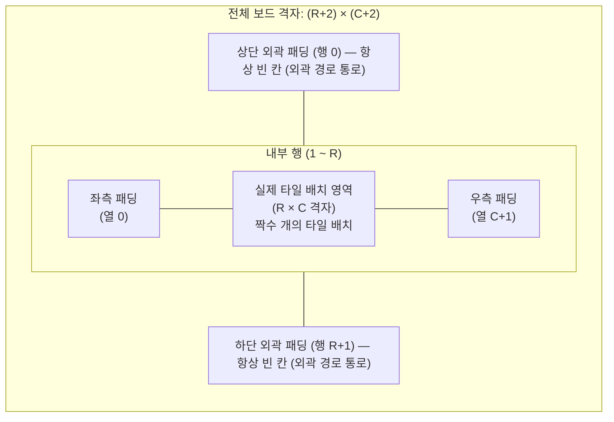
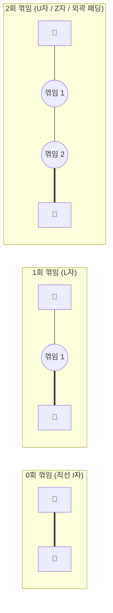
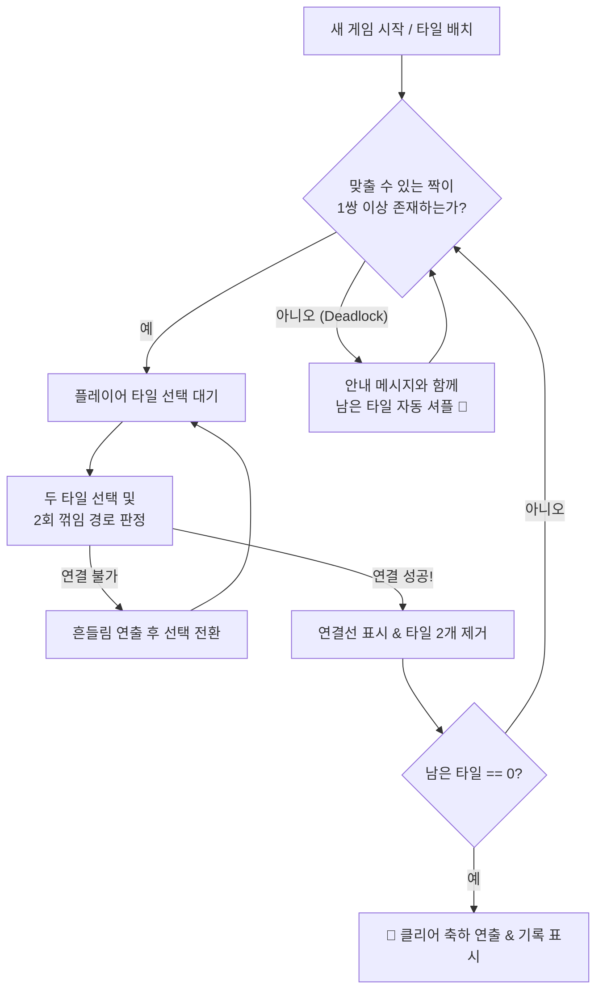

# 🍓 말랑 사천성 (Emoji Shisen-Sho) 게임 기획서

아내분이 PC와 모바일(스마트폰·태블릿) 어디서든 설치 없이 바로 즐길 수 있는 **과일·동물 이모지 기반의 캐주얼 사천성 퍼즐 웹 게임** 기획서입니다.

---

## 1. 프로젝트 개요

| 항목 | 내용 |
| :--- | :--- |
| **게임 제목 (가제)** | **말랑 사천성 (Emoji Shisen-Sho)** |
| **장르** | 2D 타일 매칭 퍼즐 (사천성 / Nikakudori) |
| **플랫폼** | PC & 모바일 반응형 웹 브라우저 (터치 & 마우스 완벽 지원) |
| **핵심 컨셉** | 외부 이미지 에셋 없이도 귀엽고 직관적인 **이모지 타일**, 막힘 없는 **자동/수동 셔플**, 따뜻한 **파스텔톤 감성 UI** |

---

## 2. 타일 그래픽 및 테마 시스템

마작 패의 복잡한 한자나 대나무 무늬 대신, 한눈에 구분되고 보기만 해도 기분 좋아지는 **이모지(Emoji) + 파스텔 배경 뱃지** 조합으로 타일을 렌더링합니다.

### 2.1 테마 프리셋 (언제든 전환 가능)
비슷한 색감의 이모지끼리 헷갈리지 않도록 형태와 색상이 뚜렷하게 구분되는 이모지를 엄선하고, 타일 내부에 은은한 파스텔 틴트 배경을 함께 부여합니다.

1. **🍎 과일 & 베리 농장 (12종)**
   - `🍎` `🍓` `🍊` `🍋` `🍌` `🍉` `🍇` `🍑` `🍒` `🍍` `🥝` `🥑`
2. **🐶 귀여운 동물 친구들 (12종)**
   - `🐶` `🐱` `🐭` `🐹` `🐰` `🦊` `🐻` `🐼` `🐨` `🐯` `🦁` `🐸`
3. **🍰 달콤 디저트 & 꽃 (12종)**
   - `🍰` `🧁` `🍩` `🍪` `🍫` `🍬` `🍭` `🍮` `🍦` `🌸` `🌻` `🌷`
4. **🌈 종합 선물세트 (최대 36종)**
   - 위 3가지 테마를 난이도별 필요 타일 종류 수에 맞춰 조합

### 2.2 타일 상태별 비주얼 피드백
- **기본 상태**: 둥근 모서리(`border-radius: 12px`)와 하단 입체 그림자(`box-shadow`)를 가진 말랑한 블록 형태
- **선택(Selected) 상태**: 타일이 살짝 위로 떠오르며(`translateY(-4px)`), 핑크/코랄빛 테두리 하이라이트와 통통 튀는 바운스 애니메이션 재생
- **매칭 성공(Matched) 상태**: 두 타일 사이에 귀여운 점선/빛줄기 경로가 `0.25초` 동안 그려진 뒤, 폭죽/별빛 파티클과 함께 작아지며 소멸
- **매칭 실패(Invalid) 상태**: 연결할 수 없는 타일을 누르면 좌우로 살짝 도리도리 흔들리는(`shake`) 애니메이션 후 새 타일로 선택 전환 (또는 선택 해제)
- **힌트(Hint) 상태**: 힌트 대상인 두 타일이 반짝이며 살랑살랑 흔들림

---

## 3. 보드 구성 및 난이도 설계

외곽으로 돌아가는 연결(`U`자 등)을 처리하기 위해, **실제 타일이 놓이는 내부 보드 $(R \times C)$의 상하좌우 바깥에 빈 칸 1줄씩 패딩을 추가한 $(R+2) \times (C+2)$ 2차원 배열**로 보드를 관리합니다.



### 3.1 난이도별 보드 크기
모든 난이도에서 **전체 타일 수는 4의 배수(또는 짝수)**로 구성하며, 각 이모지 종류당 **4장씩** 짝을 맞춰 배치합니다.

| 난이도 | 내부 격자 $(R \times C)$ | 패딩 포함 격자 | 총 타일 수 | 사용 이모지 종류 | 특징 |
| :--- | :---: | :---: | :---: | :---: | :--- |
| **🌱 쉬움 (Easy)** | $6 \times 8$ | $8 \times 10$ | 48개 | 12종 × 4장 | 모바일 한 화면에 큼직하게 들어오는 가벼운 판 |
| **🌸 보통 (Normal)** | $8 \times 10$ | $10 \times 12$ | 80개 | 20종 × 4장 | 가장 밸런스가 좋은 표준 사천성 플레이 |
| **👑 어려움 (Hard)** | $10 \times 12$ | $12 \times 14$ | 120개 | 30종 × 4장 | 다양한 동물·과일·디저트가 총출동하는 집중 모드 |

> [!TIP]
> **모바일 세로 화면 자동 회전 대응**: 화면이 세로로 긴 스마트폰에서는 격자의 행/열 비율을 자동으로 세로형(예: $8 \times 6$, $10 \times 8$, $12 \times 10$)으로 배치해 타일 크기가 작아지지 않고 큼직하게 터치되도록 설계합니다.

---

## 4. 핵심 판정 알고리즘 (2회 이하 꺾임 경로 탐색)

### 4.1 판정 조건
선택한 두 타일 $A(r_1, c_1)$와 $B(r_2, c_2)$가 제거 가능하려면 아래 조건을 만족해야 합니다.
1. **동일 타일**: 서로 다른 좌표($(r_1, c_1) \neq (r_2, c_2)$)이면서 타일의 이모지 ID가 같아야 함
2. **장애물 없는 경로**: 출발지 $A$에서 도착지 $B$까지 **빈 칸(패딩 포함)**만을 통과하여 도달 가능해야 함
3. **방향 전환 2회 이하**: 이동 중 방향이 꺾이는 횟수(`turns`)가 **최대 2회 이하**(선분 개수 기준 최대 3개)여야 함
   - **0회 꺾임 (`I`자 직선)**: 인접해 있거나 같은 행/열에서 사이에 장애물이 없는 경우
   - **1회 꺾임 (`L`자 연결)**: 한 번 꺾여서 만나는 경우
   - **2회 꺾임 (`U`자 / `Z`자 / 외곽 우회)**: 두 번 꺾여서 만나는 경우 (보드 테두리 바깥 패딩 칸을 경유하는 경우 포함)



### 4.2 탐색 알고리즘 설계 (BFS 기반 최단 꺾임 경로 탐색)
- **상태 정의**: `(row, col, direction, turns, path)`
  - `direction`: 상(`0`), 하(`1`), 좌(`2`), 우(`3`), 시작점(`-1`)
  - `turns`: 현재까지 방향이 바뀐 횟수 (`0` ~ `2`)
  - `path`: 화면에 연결선을 그리기 위해 거쳐온 좌표 배열
- **탐색 규칙**:
  1. 시작점 $(r_1, c_1)$에서 4방향으로 `turns = 0` 상태로 탐색 시작
  2. 다음 칸 $(nr, nc)$가 패딩 포함 보드 범위 내(`0 <= nr <= R+1`, `0 <= nc <= C+1`)인지 확인
  3. 직전 이동 방향과 같은 방향이면 `nextTurns = turns`, 다른 방향이면 `nextTurns = turns + 1`
  4. `nextTurns > 2`이면 가지치기(Pruning)하여 탐색 중단
  5. $(nr, nc)$가 도착점 $(r_2, c_2)$이면 **즉시 경로(`path`)를 반환 (성공)**
  6. $(nr, nc)$가 빈 칸(`null`)이고, 해당 칸에 같은 방향으로 도달했던 기존 최소 꺾임 횟수(`visited[nr][nc][dir]`)보다 `nextTurns`가 작거나 같을 때만 큐에 삽입
- **시각적 품질 향상**: 동일한 꺾임 횟수 내에서는 **전체 이동 거리(칸 수)가 가장 짧은 경로**를 우선 선택하여, 불필요하게 멀리 돌아가는 선 대신 가장 깔끔한 연결선을 렌더링합니다.

### 4.3 참고 구현: engineer-myoa/Sichuan-HELPER
[Sichuan-HELPER](https://github.com/engineer-myoa/Sichuan-HELPER)의 `helper.py`(A* 참고 BFS 풀이기)를 분석해 반영했습니다.

| 항목 | Sichuan-HELPER | 본 프로젝트 |
| :--- | :--- | :--- |
| 맵 표현 | 숫자 2차원 배열, `0` = 길, 외곽 `0` 패딩 | 동일 (`0` = 빈 칸, $(R+2)\times(C+2)$) |
| 탐색 | 한 칸씩 BFS + 꺾임 횟수 큐, 2회 초과 가지치기 | 직선 구간(segment) 단위 BFS, 최대 3구간 |
| 방문 처리 | `close` 리스트로 한 번 지난 칸 영구 차단 → 더 적은 꺾임 경로를 놓칠 수 있음 | 칸별 최소 (구간 수, 거리) 기록 후 더 좋을 때만 재방문 |
| 맵 크기 | 정사각형(`VERTEX`) 가정 | 임의의 R × C |
| 전체 스캔 | 모든 타일에 대해 연결 가능한 짝 출력 | `findAvailablePairs()` → 힌트 & 막힘 감지 & 자동 셔플 |
| 검증 | 수동 출력 확인 | 전수 조사 정답 판정기와 무작위 5,000쌍 대조 테스트 |

---

## 5. 막힘 방지 (셔플 & 힌트) 및 게임 흐름

플레이 도중 더 이상 맞출 수 있는 짝이 없어서 게임이 멈추는 일(Deadlock)이 없도록 **자동 검증 루프**를 탑재합니다.



### 5.1 전체 가용 짝 탐색 (`findAvailablePairs`)
- 현재 보드에 남아있는 같은 종류의 타일 쌍들에 대해 2회 이하 꺾임 경로가 존재하는지 검사합니다.
- 보드 크기가 최대 120타일 수준이므로, 전체 검사는 **1ms 미만**에 즉시 완료됩니다.

### 5.2 자동 셔플 & 수동 셔플 (Shuffle)
- **초기 보드 생성 보장**: 처음 타일을 깔 때도 최소 1쌍 이상 맞출 수 있는 상태가 될 때까지 섞어서 배치를 확정합니다.
- **자동 셔플 (Deadlock 발생 시)**: 타일을 제거한 직후 `findAvailablePairs()` 결과가 0개이면, **"더 이상 맞출 수 있는 짝이 없어 타일을 섞었어요! 🔀"** 토스트 알림과 함께 남은 타일들이 뒤집히듯 섞이는 애니메이션을 재생합니다. (남은 타일이 놓여 있던 좌표들은 그대로 유지한 채, 그 안의 이모지 내용물만 셔플하여 보드 형태를 보존합니다.)
- **수동 셔플 버튼**: 아직 짝이 남아있더라도 눈에 잘 보일 때 플레이어가 직접 **[섞기 🔀]** 버튼을 눌러 재배치할 수 있습니다. (수동 셔플 횟수 제한 없는 힐링 모드 기본 적용)

### 5.3 힌트 (Hint) 및 되돌리기 (Undo)
- **힌트 💡**: 버튼을 누르면 `findAvailablePairs()`에서 찾은 첫 번째 쌍의 두 타일을 반짝이게 강조해 줍니다.
- **되돌리기 ↩️**: 방금 제거한 타일 쌍의 좌표와 종류를 스택에 저장해 두어, 원할 때 이전 상태로 되돌릴 수 있습니다.

---

## 6. 아내분 취향 저격 디테일 (UI / UX & 연출)

1. **힐링 모드 (타이머 스트레스 ZERO)**
   - 시간에 쫓기며 조급해지지 않도록 기본적으로 **시간제한으로 인한 게임오버를 없애고**, 클리어까지 걸린 시간만 부드럽게 기록합니다. (원할 때만 켜는 타임어택 토글 또는 콤보 보너스만 유지)
2. **연속 매칭 콤보 (Combo) 연출**
   - 3초 이내에 연속으로 짝을 맞추면 `2 Combo!`, `3 Combo! ✨` 말풍선이 떠오르며 타일 제거 파티클이 더 화려해집니다.
3. **Web Audio API 기반 귀여운 효과음 (에셋 파일 불필요)**
   - 외부 MP3 파일 없이 브라우저 내장 신디사이저(Web Audio API)로 맑고 경쾌한 **마림바/실로폰 느낌의 톡톡 튀는 클릭음**, 매칭 성공 시 **도-미-솔 화음**, 콤보 시 **음계 상승 효과**, 클리어 시 **축하 팡파레**를 구현합니다. (상단 스피커 버튼으로 언제든 ON/OFF 가능)
4. **반응형 한 화면 레이아웃**
   - 스크롤이 전혀 발생하지 않도록 화면 크기(`100dvh`)에 맞춰 타일 크기와 여백이 자동 계산됩니다.

---

## 7. 기술 스택 및 구현 구조 제안

설치나 복잡한 환경 설정 없이 언제든 열람·수정이 쉽고 빠르게 동작하도록 **순수 웹 표준(Vanilla HTML5 / CSS3 / ES6+ JavaScript)** 구조로 구현합니다.

```text
Shisen-Sho/
├── index.html          # 메인 게임 화면 및 UI 레이아웃
├── css/
│   └── style.css       # 파스텔 테마, 반응형 그리드, 타일/파티클 애니메이션
├── js/
│   ├── main.js         # 게임 루프, 이벤트 바인딩, 상태 관리
│   ├── board.js        # 패딩 보드 생성, 타일 셔플, Deadlock 감지, Undo 관리
│   ├── pathfinder.js   # 2회 이하 꺾임 BFS 경로 탐색 알고리즘
│   ├── renderer.js     # 타일 DOM 렌더링, SVG 연결선 애니메이션, 폭죽 파티클
│   ├── sound.js        # Web Audio API 기반 내장 효과음 합성기
│   └── themes.js       # 과일·동물·디저트 이모지 프리셋 및 컬러 팔레트 정의
└── SPEC.md             # 본 게임 기획서 문서
```
